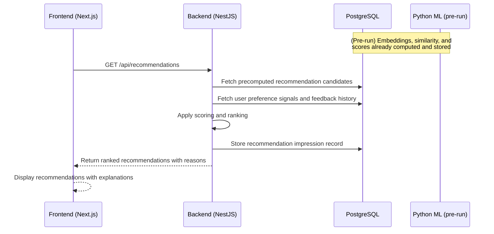
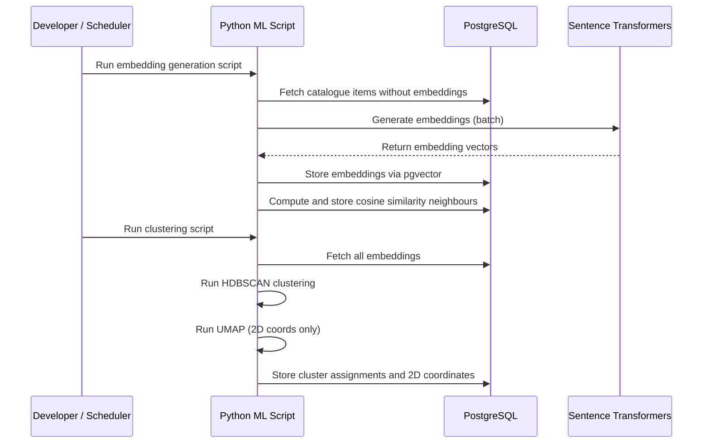
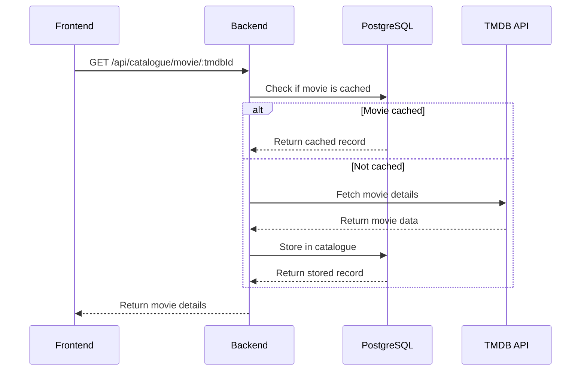
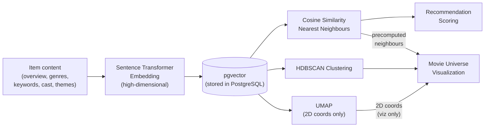
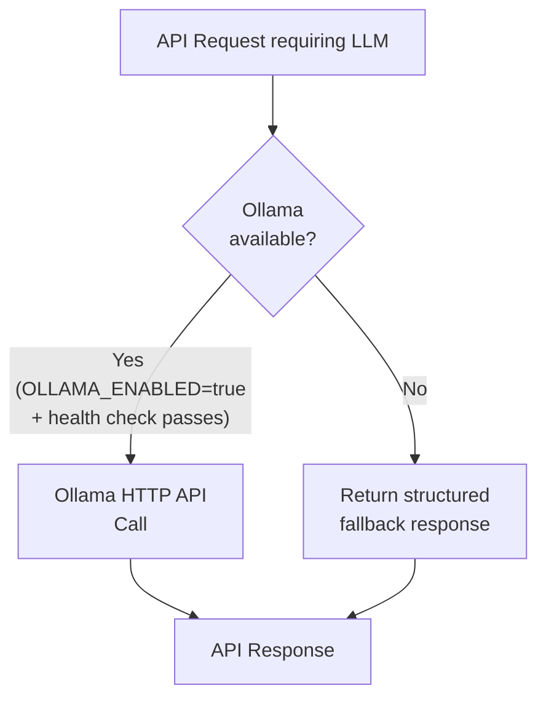

# CineSphere — System Architecture

**Status:** Active / Implemented Baseline (Phases 1, 2, 3.0–3.5 Verified)  
**Last Updated:** 2026-11-08  
**Version:** 1.2

> This document describes the CineSphere system architecture. The foundation (Phase 1), catalogue and TMDB integration (Phase 2), and personal library & tracking system (Phase 3 Stages 3.0–3.5) are fully implemented and verified with automated test suites. Future domains (recommendation engine, ML pipeline, Movie Universe) remain design specifications.

---

## 1. Architectural Overview

CineSphere is structured as a **TypeScript monorepo** containing a Next.js frontend and a NestJS backend, with a **separate Python ML package** that runs as offline or on-demand scripts. All components share a single PostgreSQL database.

The design prioritizes:

- **Clarity of responsibility** — the frontend, backend, and ML layer each have well-defined boundaries.
- **Simplicity** — no microservices, no message queues, no containers that wouldn't exist in a simple project. Complexity is introduced only when it solves a demonstrated problem.
- **Offline-first ML** — Python ML scripts run on-demand rather than as a permanently running service, which avoids premature infrastructure complexity.
- **Single data store** — PostgreSQL with the pgvector extension serves as both the relational application database and the vector similarity engine.

```mermaid
flowchart TD
    subgraph Client["Browser"]
        UI["Next.js Frontend\n(apps/web)"]
    end

    subgraph Backend["NestJS API\n(apps/api)"]
        API["REST API Layer"]
        Services["Business Logic Services"]
        PrismaClient["Prisma ORM Client"]
    end

    subgraph MLLayer["Python ML Package\n(ml/) — runs on-demand"]
        EmbedGen["Embedding Generation\n(Sentence Transformers)"]
        Similarity["Similarity Computation\n(cosine, pgvector)"]
        Clustering["HDBSCAN Clustering"]
        UMAP["UMAP 2D Reduction\n(visualization only)"]
        Scoring["Recommendation Scoring"]
        TasteProfiling["Taste Profiling"]
    end

    subgraph DataLayer["Data Layer"]
        PG[("PostgreSQL 16+\nwith pgvector")]
        TMDB["TMDB API\n(external)"]
        Ollama["Ollama\n(optional, local)"]
    end

    UI -->|REST HTTP| API
    API --> Services
    Services --> PrismaClient
    Services -->|HTTP| TMDB
    Services -->|HTTP (optional)| Ollama
    PrismaClient -->|SQL + pgvector| PG
    MLLayer -->|Direct SQL / psycopg2| PG
    MLLayer --> EmbedGen
    MLLayer --> Similarity
    MLLayer --> Clustering
    MLLayer --> UMAP
    MLLayer --> Scoring
    MLLayer --> TasteProfiling
```

---

## 2. Component Responsibilities

### 2.1 Frontend — `apps/web/` [Implemented & Active]

**Technology:** Next.js 14+ (App Router) with TypeScript, Tailwind CSS

**Implemented Routes & Pages:**

- `/` — Personal Dashboard with Viewing Summary cards, Continue Watching section (progress bars, next-episode calculations), Recent Activity feed, and Quick Picks catalogue recommendations.
- `/discover` — TMDB search, curated popular/trending content, genre/year filters, and catalogue browsing with debounced search input.
- `/library` — My Library page with 5 status tabs (All, Watching, Plan to Watch, Completed, Dropped), media type filtering, sorting, pagination, and empty/error states.

**Implemented Components:**

- `Navbar` — Responsive navigation header with active page indicators (Dashboard, Discover, My Library).
- `StatCard` / `ContinueWatchingCard` / `RecentActivityRow` / `QuickPickCard` — Dashboard widget components with loading skeletons and empty states.
- `LibraryCard` — Visual card displaying poster, title, status badge, media type badge, personal rating badge, watch counts (movies) or episode progress bar (TV), and "Manage Tracking" trigger.
- `AddLibraryModal` — Dialog for adding any movie or TV show to the personal library with status selection, optional 1.0–10.0 rating, notes, and 409 conflict handling.
- `LibraryDetailModal` — Comprehensive tracking modal:
  - Status pill selection and personal rating dropdown.
  - Personal notes editor with save feedback.
  - Movie tracking: viewing event logging form (date, rating, notes) and chronological viewing history timeline.
  - TV tracking: overall progress bar, "Mark All Watched" batch action (with specials toggle), season-by-season accordion, per-episode watched toggles, and per-season ratings.
  - Delete entry action with confirmation modal.
- `MediaCard` — Reusable catalogue card with image generator, TMDB attribution, and "Add to Library" integration.
- `EmptyState`, `ErrorState`, `LoadingSpinner`, `TmdbAttribution`.

**State Management & Data Fetching:**

- Typed `ApiClient` class (`apps/web/src/lib/api-client.ts`) with custom fetch wrapper, typed error handling, and abort controller support.
- React state with custom hooks (`useDebounce`) and modal lifecycle state.

**Does not:**

- Contain business logic (recommendation scoring, statistics aggregation, etc.).
- Connect to TMDB, PostgreSQL, or Ollama directly.
- Perform embedding or ML operations.

---

### 2.2 Backend — `apps/api/` [Implemented & Active]

**Technology:** NestJS with TypeScript

**Implemented Modules & Services:**

- `DatabaseModule`: Global database access via `PrismaService`, `VectorRepository` (pgvector raw SQL operations), `SingleUserBootstrap` (validates and seeds deterministic user anchor), and `DatabaseErrorMapper` (maps Prisma/Postgres/trigger errors to HTTP exceptions).
- `HealthModule`: System health checks and pgvector status diagnostics (`GET /api/health`).
- `TmdbModule`: TMDB integration with `TmdbHttpClient` (Bearer token auth, exponential retry, rate limiting), `TmdbMapper`, `CatalogueRepository`, `TmdbService`, `DiscoverController`, and `TmdbController`.
- `CatalogueModule`: Local database catalogue browsing, filtering, search, and details endpoints (`GET /api/catalogue/movies`, `/tv`, `/movies/:id`, `/tv/:id`).
- `LibraryModule`: Personal library management (`POST/GET/PATCH/DELETE /api/library`, viewing events, episode progress, mark-all-watched, season ratings).
- `DashboardModule`: Consolidated dashboard data aggregation (`GET /api/dashboard/overview`, `/stats`, `/continue-watching`, `/recent-activity`, `/quick-picks`).
- Swagger / OpenAPI documentation automatically generated and served at `/api/docs`.

**Does not:**

- Contain ML logic (embedding generation, clustering, UMAP). Those live in the Python `ml/` package.
- Render the UI.

---

### 2.3 Shared Packages — `packages/` [Implemented & Active]

**`packages/shared/`:** Shared TypeScript types, interfaces, DTOs, and utility functions used by both `apps/web` and `apps/api`:

- Dashboard types: `DashboardOverviewResponse`, `DashboardStats`, `ContinueWatchingItem`, `RecentActivityItem`, `QuickPickItem`, `NextEpisodeInfo`.
- Library types: `LibraryMediaType`, `LibraryStatus`, `LibraryEntryResponse`, `ViewingEventResponse`, `EpisodeProgressResponse`, `SeasonRatingResponse`, `LibraryEntryStats`.
- Media types: `MovieDetails`, `TvShowDetails`, `SeasonDetails`, `EpisodeDetails`, `Genre`, `PersonCredit`.
- TMDB types: search results, trending/popular responses, pagination contracts.
- Health and vector diagnostic types.

**`packages/config/`:** Shared ESLint, Prettier, and TypeScript configurations ensuring strict type checking and consistent formatting across the monorepo.

---

### 2.4 Python ML Package — `ml/` [Scaffolding Implemented, Algorithms Planned for Phase 5+]

**Technology:** Python 3.12, Pytest, Ruff (active); Sentence Transformers, scikit-learn, HDBSCAN, UMAP-learn (planned)

**Active Baseline:**

- Python virtual environment with `pyproject.toml` packaging.
- Ruff linting and formatting configured and clean.
- Pytest suite configured with baseline test suite (4/4 passing).

**Planned ML Responsibilities (Phase 5+):**

- Generate semantic embeddings for catalogue items using Sentence Transformers.
- Compute cosine similarity and precompute nearest-neighbour relationships.
- Run HDBSCAN clustering on high-dimensional embedding space.
- Run UMAP to generate 2D coordinates for visualization only.
- Compute recommendation scores and taste profile snapshots.
- Write results directly back to PostgreSQL.

**Operating model:** Scripts run on-demand — triggered manually, by the backend, or on a schedule. There is no permanently running ML service.

---

### 2.5 Infrastructure & CI — `infrastructure/` & `.github/` [Implemented & Active]

**Local Development Environment:**

- PostgreSQL 16 with pgvector extension (`pgvector/pgvector:pg16`) via `docker-compose.yml`.
- Next.js and NestJS run on the host system with fast HMR.

**Continuous Integration (`.github/workflows/ci.yml`):**

- Two parallel jobs: `typescript` and `python`.
- `typescript` job utilizes a containerized PostgreSQL 16 + pgvector service, executes `prisma generate`, `typecheck`, `lint`, `format:check`, `pnpm test` (unit tests), applies migrations via `prisma migrate deploy`, runs 137 backend integration tests (`test:integration`), and performs production builds (`pnpm build`).
- `python` job runs Ruff lint, Ruff format check, and Pytest on Python 3.12.

---

## 3. Data Flow

### 3.1 User Requests a Recommendation



### 3.2 ML Pipeline Execution (On-Demand)



### 3.3 TMDB Data Fetch and Cache



---

## 4. Database Responsibilities

PostgreSQL with pgvector serves as the single data store. Its responsibilities:

| Responsibility                                        | Table/Schema Area                                    |
| ----------------------------------------------------- | ---------------------------------------------------- |
| Catalogue metadata (movies, TV, seasons, episodes)    | Catalogue tables                                     |
| Personal library entries, statuses, ratings, progress | Library tables                                       |
| Semantic embeddings (pgvector `vector` type)          | `MediaEmbedding`                                     |
| Precomputed cosine similarity neighbours              | `MediaSimilarity`                                    |
| Cluster assignments and UMAP 2D coordinates           | `ClusterAssignment`                                  |
| Recommendation records, scores, and reasons           | `RecommendationRecord`                               |
| Recommendation feedback and impressions               | `RecommendationFeedback`, `RecommendationImpression` |
| Taste profile and historical snapshots                | `TasteProfile`, `TasteProfileSnapshot`               |
| User preferences and settings                         | `UserPreference`                                     |

> See [`DATABASE_DESIGN.md`](DATABASE_DESIGN.md) for the full proposed schema.

---

## 5. Embedding and Similarity Architecture

This is a critical design area. The rules are firm:

1. **Embeddings are generated from:** item overview, genres, keywords, cast/character names where available, inferred themes, tone descriptors, and narrative style descriptors. The specific content representation is a pending decision (TD-07, TD-08) to be validated on real data.

2. **Cosine similarity is used** for all nearest-neighbour calculations. This is computed in high-dimensional embedding space — never on UMAP 2D coordinates.

3. **UMAP coordinates are for visualization only.** They are stored separately from embeddings and must never be used as input to similarity computation, recommendation scoring, or clustering.

4. **HDBSCAN clusters** are computed on the high-dimensional embedding space. HDBSCAN is preferred over k-means because it handles variable-density clusters and correctly marks noise points (items that don't belong to any cluster).

5. **Nearest neighbours are precomputed** and stored in `MediaSimilarity`. The pgvector `<=>` operator (cosine distance) is used for database-side vector operations. Exact nearest neighbour search is acceptable at typical catalogue sizes; approximate nearest neighbour (pgvector HNSW index) may be enabled if performance requires it.



---

## 6. Recommendation System Architecture

The recommendation engine is **independent of LLM availability**. Ollama enhances certain features but is never required for recommendations.

### 6.1 Scoring Model

```
Score = 0.35·S + 0.25·P + 0.20·M + 0.10·Q + 0.10·N
```

| Component               | Description                                                                     | Source                     |
| ----------------------- | ------------------------------------------------------------------------------- | -------------------------- |
| S — Semantic Similarity | Cosine similarity between item embedding and positive user preference embedding | pgvector                   |
| P — Preference Match    | Match against genre, theme, and style preference signals derived from library   | Library ratings + feedback |
| M — Mood Match          | Match against current mood context (predefined mood categories or LLM-parsed)   | User input / Ollama        |
| Q — Quality Signal      | Normalized TMDB rating × popularity, adjusted for recency                       | TMDB metadata              |
| N — Novelty             | Penalizes items too similar to recently recommended or recently watched         | Recommendation history     |

**These weights are initial experimental values and must be configurable.** They are not proven optimal. Weights should be tunable via configuration and evaluated over time against stored recommendation outcome data.

### 6.2 User Preference Representation

A single averaged "user embedding" loses information about preference polarity. CineSphere maintains:

- **Positive preference embedding:** weighted average of embeddings of titles rated highly or given positive feedback. Weights are proportional to rating or feedback strength.
- **Negative preference embedding:** weighted average of embeddings of titles that were dropped, given negative feedback, or explicitly disliked.

Both are computed by the Python ML layer and stored. The scoring model uses both.

### 6.3 Diversity Modes

| Mode            | Behaviour                                                                       |
| --------------- | ------------------------------------------------------------------------------- |
| Safe (Familiar) | High weight on semantic similarity. Narrow candidate pool. Low novelty penalty. |
| Balanced        | Default weights as above.                                                       |
| Experimental    | Increased novelty weight. Broader candidate pool. Wider diversity within batch. |

Diversity within a recommendation batch (intra-list diversity) is applied after initial ranking to avoid showing ten variations of the same thing.

---

## 7. Local vs. Hosted Operating Mode

| Capability                | Local Mode                        | Hosted Portfolio Mode                  |
| ------------------------- | --------------------------------- | -------------------------------------- |
| Core library tracking     | ✓ Available                       | ✓ Available (read-only in demo)        |
| TMDB search and catalogue | ✓ Available                       | ✓ Available                            |
| Recommendation engine     | ✓ Available (live computation)    | ✓ Available (from precomputed data)    |
| Movie Universe map        | ✓ Available (live embedding data) | ✓ Available (precomputed fixture)      |
| Statistics                | ✓ Available                       | ✓ Available (from fixture data)        |
| Ollama LLM features       | ✓ Available (if Ollama running)   | ✗ Disabled                             |
| Conversational discovery  | ✓ Available (if Ollama running)   | ✗ Disabled                             |
| Personal data             | ✓ Full personal data              | ✗ Anonymized/curated fixture only      |
| Embedding generation      | ✓ Runs on-demand                  | Pre-deployed — no on-demand generation |

**The `HOSTED_MODE` environment variable** switches behaviour. When set to `true`:

- Ollama feature flags are forced off regardless of other config.
- Write operations may be restricted (read-only demo mode).
- The application loads from precomputed fixture data for ML results.

---

## 8. Optional LLM Integration Architecture



Ollama integration points:

1. **Conversational discovery** — parse natural language into catalogue filter parameters.
2. **Taste profile narration** — generate a readable prose description of the structured taste profile.
3. **Mood interpretation** — map freeform mood descriptions to genre/theme/tone signals.

None of these integration points affect the recommendation scoring pipeline. The recommendation engine never calls Ollama.

---

## 9. Error Handling Strategy

**At the API boundary:**

- All controllers use validation pipes (NestJS `ValidationPipe`) to reject malformed requests with clear error messages.
- API errors return consistent JSON error shapes with an HTTP status code, error code, and message.
- 500-level errors are caught by a global exception filter and logged without exposing internal stack traces to the client.

**TMDB API failures:**

- If TMDB is unavailable, return cached data if present, or a clear error message.
- Apply retry logic with exponential backoff for transient failures.
- Rate limit errors (429) are handled with automatic retry after the specified delay.

**Ollama failures:**

- If Ollama is not reachable, the backend marks LLM features as unavailable.
- LLM-dependent API endpoints return a `503` with a `LLM_UNAVAILABLE` error code.
- The frontend renders an appropriate fallback or disabled state — no unhandled error.

**Import failures:**

- Validation errors for individual import records are collected and returned in the response.
- Invalid records are never silently discarded.
- If the transaction fails mid-import, the entire operation rolls back.

**ML pipeline failures:**

- Scripts emit detailed error output and exit with non-zero codes.
- Partial results are not written to the database — write operations occur after all computations succeed.
- The API does not expose ML pipeline failures directly to users; it surfaces a simplified status.

---

## 10. Security Boundaries

- **Secrets:** All API keys, database credentials, and configuration are injected via environment variables. `.env` is excluded from version control. `.env.example` documents required variables without values.
- **Input validation:** All API request bodies, query parameters, and path parameters are validated using class-validator decorators in NestJS DTOs.
- **Database:** Prisma's query builder prevents SQL injection in parameterized queries. Raw SQL (`$queryRaw`) is used only where necessary (pgvector operations) and must use parameterized form — never string interpolation.
- **Import files:** Uploaded files are validated for content type, structure, and size before processing. File contents are never executed or eval'd.
- **Authentication:** See TD-10. At minimum, the hosted demo requires some form of access control to prevent write operations.
- **Logging:** Personal watch history, ratings, and other user data are not included in log output.

---

## 11. Scalability Considerations

CineSphere is a single-user personal application. The architectural choices below are appropriate for this scale:

| Area                  | Current Approach             | Upgrade Path (If Needed)                                                       |
| --------------------- | ---------------------------- | ------------------------------------------------------------------------------ |
| Vector search         | pgvector exact cosine search | Enable HNSW index for approximate nearest neighbour if search latency degrades |
| Embedding computation | On-demand Python scripts     | Dedicated ML service (not needed now)                                          |
| Database              | Single PostgreSQL instance   | Managed PostgreSQL (Neon, Supabase) for hosted deployment                      |
| Caching               | No explicit cache layer      | Add database query result caching if measured latency warrants it              |
| Background jobs       | On-demand scripts            | Simple job queue (pg-boss, BullMQ) if real-time triggers become necessary      |

**Do not introduce Redis, Kafka, Kubernetes, or other infrastructure without a demonstrated, measured performance problem.** Document the problem before proposing the solution.

---

## 12. Architectural Decisions Log

| ID    | Decision                                            | Rationale                                                                                                                                                                                                                            |
| ----- | --------------------------------------------------- | ------------------------------------------------------------------------------------------------------------------------------------------------------------------------------------------------------------------------------------ |
| AD-01 | TypeScript monorepo                                 | Shares types between frontend and backend without duplication. Single repository simplifies development.                                                                                                                             |
| AD-02 | Python ML as offline scripts, not a service         | No justification for a persistent ML service at this scale. Scripts are simpler to maintain and debug.                                                                                                                               |
| AD-03 | PostgreSQL as the sole data store                   | Avoids polyglot persistence complexity. pgvector brings vector operations into PostgreSQL.                                                                                                                                           |
| AD-04 | Prisma ORM                                          | Type-safe database access. Prisma's migration system is appropriate for a TypeScript project. Raw SQL used only where Prisma cannot express the operation (pgvector).                                                                |
| AD-05 | UMAP for visualization only                         | UMAP distorts distances. Using 2D coordinates for similarity would produce incorrect results. The original high-dimensional embeddings are the semantic source of truth.                                                             |
| AD-06 | HDBSCAN over k-means                                | HDBSCAN finds natural cluster boundaries and handles noise. k-means requires a predetermined cluster count and assumes spherical clusters.                                                                                           |
| AD-07 | Recommendation engine independent of LLM            | LLM unavailability must not break recommendations. LLMs are probabilistic and difficult to evaluate. Deterministic scoring is auditable and improvable.                                                                              |
| AD-08 | On-demand TMDB fetch and local cache                | Avoids bulk catalogue processing upfront. Grows the local catalogue incrementally as the user explores.                                                                                                                              |
| AD-09 | Separate positive and negative preference signals   | A single averaged user embedding loses polarity information. Maintaining both produces more precise preference matching.                                                                                                             |
| AD-10 | Atomic import transactions                          | Partial imports that corrupt the database are worse than failed imports. Roll back cleanly.                                                                                                                                          |
| AD-11 | Turborepo with pnpm workspaces (TD-02 resolved)     | Selected over Nx. Provides fast task orchestration, pipeline caching, and native Next.js integration without Nx's high maintenance overhead or enterprise complexity.                                                                |
| AD-12 | Prisma + pgvector isolated pattern (TD-04 resolved) | Prisma manages standard relational schema and migrations (`CREATE EXTENSION IF NOT EXISTS vector`). pgvector vector calculations are strictly encapsulated in `VectorRepository` via parameterized `$queryRaw`. Avoids a second ORM. |

---

## 13. Resolved Technical Decisions Detail

### 13.1 Resolution of TD-02: Monorepo Tooling (Turborepo vs. Nx)

- **Selected:** Turborepo 2.x with pnpm 10 workspaces (`pnpm-workspace.yaml`).
- **Evaluation Summary:**
  1. _Configuration Complexity:_ Turborepo uses a single declarative `turbo.json`, whereas Nx introduces project graphs, executors, and heavy generator plugins.
  2. _Next.js & NestJS Integration:_ Turborepo natively supports Next.js App Router and allows NestJS to compile cleanly via Nest CLI without framework plugins.
  3. _Dependency Management:_ Fully delegated to pnpm workspaces (`workspace:*`), ensuring fast, symlinked, deterministic installations.
  4. _Maintenance Overhead:_ Minimal. Turborepo stays unobtrusive and does not require periodic monorepo framework migration scripts.
- **Python ML Decoupling:** The `ml/` Python package operates independently with its own `pyproject.toml` and virtual environment, completely decoupled from JavaScript workspace dependency graphs.

### 13.2 Resolution of TD-04: Prisma + pgvector Integration Pattern

- **Selected:** Hybrid Prisma Relational + Encapsulated pgvector Raw SQL (`VectorRepository`).
- **Evaluation Summary:**
  1. _Relational Operations:_ Handled 100% by Prisma Client (type-safe queries, relations, interactive transactions).
  2. _Extension & Migration Management:_ Handled via Prisma migrations (`CREATE EXTENSION IF NOT EXISTS vector;` executed in migration SQL).
  3. _Vector Operations:_ pgvector cosine similarity operators (`<=>`) are executed via parameterized `prisma.$queryRaw` queries strictly inside `apps/api/src/database/vector.repository.ts`.
  4. _Anti-Scatter Rule:_ Raw SQL is never permitted inside NestJS controllers or general domain services. All vector operations must route through `VectorRepository`.
  5. _TD-08 Dependency Handling:_ Vector column dimensions (384 vs 768) are not permanently locked in Phase 1. The pgvector extension is verified with dynamic operations; the final `MediaEmbedding.embedding` column definition and HNSW index will be migrated in Phase 5 upon formal evaluation of the embedding model.
